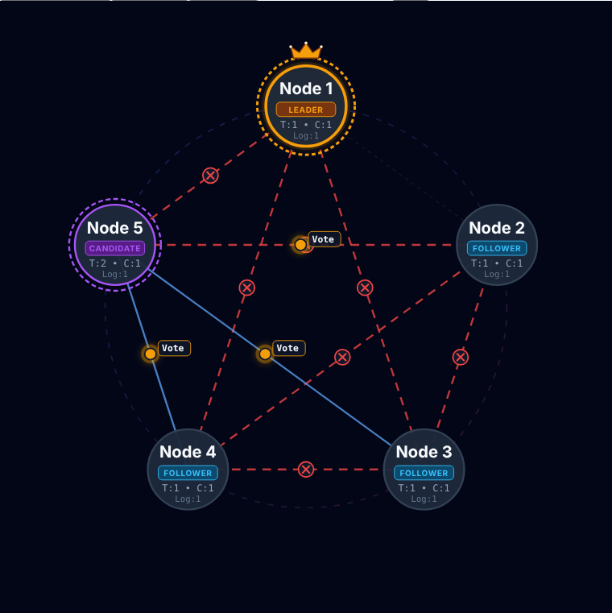
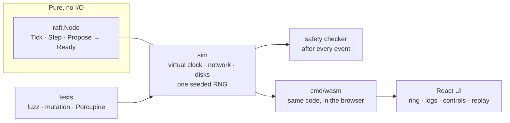

# raft-lab

**Raft consensus from scratch in Go, built on a deterministic simulator, with a browser visualizer you can break.**

[**▶ Live demo**](https://anaxmd.github.io/raft-lab/) · runs the real Go code in your browser via WebAssembly



Raft is the algorithm behind etcd, Consul and CockroachDB: it lets several machines agree on one
sequence of events even when machines crash and the network drops, delays or duplicates messages.

This project is about two things: **implementing it**, and **being able to prove it is correct**.
Every run is driven by a single seed, so any failure the tests find can be replayed exactly.

## What's implemented

- Leader election, log replication, commit rule (including the Figure 8 case from the Raft paper)
- PreVote and CheckQuorum (stop a disconnected node from disrupting a healthy cluster)
- Durability discipline: persist and fsync, *then* send, then apply; unsynced writes are lost on crash
- Crash and restart with state recovered from the (simulated) disk
- A key-value state machine on top of the log, checked for linearizability
- A React visualizer running the same Go code as the tests (compiled to WebAssembly)

## How it is verified

| Technique | What it shows |
|---|---|
| **Deterministic simulator** | One seeded RNG, a virtual clock, no goroutines, no `time.Now`. Same seed ⇒ same run, byte for byte (golden trace test). |
| **Safety checker after every event** | Election safety, log matching, leader completeness, state-machine safety. Any violation fails the run immediately. |
| **Fuzzing across seeds** | Random crashes, restarts, partitions, isolations, 15% loss, duplication and delays, with proposals throughout. After healing, every node must converge. |
| **Mutation checks** | I deliberately broke Raft rules (and the fsync ordering) by hand to confirm the tests *fail*; the mutants are not automated in the repo. `TestM4_SkipSyncIsCaught` keeps one such bug alive permanently. |
| **Linearizability** | Concurrent client histories from the KV store, checked with [Porcupine](https://github.com/anishathalye/porcupine). Operations lost to a crash are treated as "outcome unknown". |
| **Session replay** | The live demo records every command with the *virtual* time it took effect. Replaying a session gives an identical event stream, however fast it was played live. |

## Architecture



The key design decision: the Raft node is a **pure state machine**. You feed it ticks, messages and
proposals; it returns a `Ready` batch (what to persist, send and apply). It never touches a network,
a disk or a clock, so the *same* code runs in the test simulator and in your browser.

### Rules that keep it deterministic
No goroutines in the simulator, no `time.Now`, no global `rand`, and no behavior that depends on map
iteration order (nodes are always visited through the sorted `s.ids`). Events are ordered by
`(time, phase, seq)`; user commands run after all normal events at the same instant, which is what
makes replay exact.

## Try it

```bash
go test ./...                                   # everything (the M6 linearizability sweep is the slowest)
go test ./sim ./raft -race                      # simulator + checker
FUZZN=2000 go test ./test -run Fuzz -v          # a bigger fuzz sweep
go test ./test -run M3 -seed=48213 -v           # replay one exact run

go run ./cmd/trace -seed 182 > trace.ndjson     # the built-in "leader crash" scenario as a trace
go run ./cmd/trace -session my-session.json     # replay a session downloaded from the demo
```

Visualizer (Node 22 and Go 1.24+):

```bash
cd ui
npm ci
npm run build:wasm     # compiles ../cmd/wasm to public/sim.wasm and copies wasm_exec.js
npm run dev
```

In the app: **Start Live Session**, then use the **Controls** tab to write data, partition the
cluster, add message loss or delay, crash nodes, change the speed, and download the session.
**Load** replays a downloaded session (or opens an NDJSON trace) and you can scrub through time.

## Layout

| Path | What |
|---|---|
| `raft/` | The Raft node (`node.go`) and its types |
| `sim/` | Simulator, fake disk, safety checker, trace emitter, session record/replay |
| `test/` | Milestone tests (M2–M6) swept over many seeds, plus the fuzz test |
| `cmd/trace` | Writes NDJSON traces for the viewer |
| `cmd/wasm` | The `RaftSim` bridge exposed to the browser |
| `ui/` | React + TypeScript + Vite visualizer |

<details>
<summary>Trace and session formats</summary>

A trace is NDJSON: a header (`{v, seed, nodes}`) followed by events: `send`, `deliver`, `drop`,
`node`, `log`, `fault`, `propose`, `net`, `violation`. Network faults carry the *complete* set of cut
links in `cuts` (absent means none), so any point in the trace can be rendered without history.

A session is one JSON document: `{v, seed, config, commands[], until}`, where each command is
stamped with the virtual time at which it took effect. The wire contract is documented in
`sim/trace.go` and `sim/session.go`.
</details>

## Limitations (and what I'd do next)

- **Simulated, not networked.** Time, network and disk are simulated. There is no real transport or on-disk storage.
- **No snapshots / log compaction** and **no membership changes**: the cluster size is fixed at start.
- **Reads go through the Raft log.** That is linearizable and is what M6 tests, but it does not implement fast leader-local reads (`ReadIndex`), which would be the next step for read scaling.
- **No leader leases.** PreVote and CheckQuorum make disruption rare, but a healthy cluster can still be disturbed under unlucky timings.
- **No client request deduplication.** A retried write can be applied twice.
- The visualizer keeps every event of a live run in memory, so very long sessions will grow; speed is capped at 5× for that reason.
